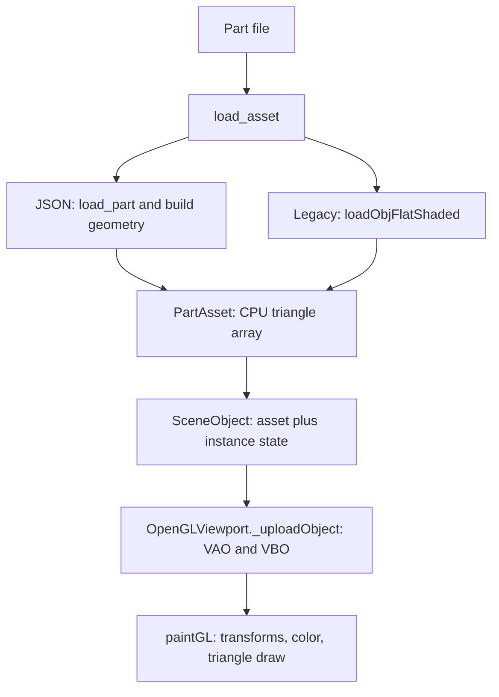

# SimuOPart developer guide

This guide describes the production code in `src/`: the `.simuOPart` asset,
its scene instances, rendering, property editing, persistence, and physics.
See the [source-file documentation index](../README.md) for module guides.
There is no class named `SimuOPart`; the main types are `Part`, `PartAsset`,
`SceneObject`, `Sketch`, and `FeatureModel`.

## 1. Data ownership and file formats

| Layer | Type / file | Responsibility |
| --- | --- | --- |
| Reusable definition | `Part` in [part_format.py](../../src/part_format.py) | Validated geometry, material, mass, appearance, spawn defaults, metadata |
| CPU render asset | `PartAsset` in [part_assets.py](../../src/part_assets.py) | Triangle vertex array and optional `Part` definition |
| Scene instance | `SceneObject` in [scene.py](../../src/scene.py) | Asset reference, transform, motion, body type and bounce overrides |
| Editable feature history | `FeatureModel` in [feature_geometry.py](../../src/feature_geometry.py) | Supported sketches, extrusion history, rebuilt solid and selectable faces |
| Editable sketch | `Sketch` in [sketch_geometry.py](../../src/sketch_geometry.py) | Points, curves, dimensions, constraints, thickness |
| Saved scene | `.simuO` | References external part files and stores instance settings |

The `.simuOPart` extension can contain several representations. Loading is
dispatched by **content**, rather than the extension alone:

| Representation | Geometry | Editable in current Part Editor? |
| --- | --- | --- |
| JSON version 1 | `geometry.type = "box"`, three positive sizes | Yes; migrated to a rectangular sketch and symmetric extrusion |
| JSON version 2 | `geometry.type = "sketch"`, one outline and thickness | Yes; migrated to feature history |
| JSON version 3 | `geometry.type = "feature_part"`, ordered features | Yes; current editor's save format |
| Legacy OBJ text | Vertex and face records, including `.simuOPart` copies of OBJ files | No editable sketch/history |

`load_asset()` skips leading whitespace and recognizes `{` or `[` as JSON.
Malformed JSON is rejected; it is never retried as an OBJ mesh. Legacy assets
have `asset.part is None`, default gray appearance, and static scene behavior
unless explicitly changed.

JSON definitions require `format`, `version`, `id`, `name`, `units`,
`coordinates`, `geometry`, `appearance`, `material`, `physics`, and
`initial_state`. `description` and `properties` are optional.

| Field | Contract / effect |
| --- | --- |
| `format` | Exactly `".simuOPart"` |
| `units` | Exactly `{"length":"m","mass":"kg","time":"s"}` |
| `coordinates` | Exactly `{"handedness":"right","up":"+Y"}` |
| `appearance.color` | `#RRGGBB`; scene shader base color |
| `material` | Nonempty name, positive density in kg/m³, nonnegative friction, restitution in [0, 1] |
| `physics.body_type` | `"dynamic"` or `"static"` |
| `physics.mass_source` | `"density"` computes mass from volume; `"explicit"` requires `mass` in kg |
| `physics.collider` | Currently only `"geometry"` |
| `initial_state` | Three-component position in metres and velocity in m/s; static definitions require zero velocity |
| `properties` | Object with namespaced keys such as `"company:stock_code"`; inert metadata |

Use [Assets/aluminum_cube.simuOPart](../../Assets/aluminum_cube.simuOPart) as a
complete v1 example and [feature editor guide](../Frontend/feature_editor.md) for v3 geometry.
The loader rejects unknown schema fields, duplicate JSON keys, non-finite
numbers, unsupported versions, and invalid geometry. Custom application data
belongs under `properties`, rather than new arbitrary top-level fields.

Stored geometry uses metres; sketch and extrusion controls display millimetres.
Scene Euler rotations use degrees, while angular velocity passed to Bullet uses
radians per second. Scene scale is dimensionless.

## 2. How a part becomes a rendered object



### File parsing and geometry construction

1. `SceneObject(meshPath=...)` calls `load_asset()` once for that instance and
   retains `asset` and `part`. JSON position and velocity initialize the
   instance; its default name comes from the part name. Legacy names use the
   filename stem. There is no global asset cache shared across all instances.
2. `load_part()` validates the JSON and returns a frozen `Part` dataclass.
   `allow_draft=True` permits unfinished documents for editing; normal scene
   import requires a closed v2 sketch or a v3 solid.
3. Geometry becomes a flat NumPy `float32` array with six values per vertex:
   `[x, y, z, nx, ny, nz, ...]`. Every three vertices form a triangle.
   There is no index buffer in this rendering path.

The mesh builders differ by format:

- **Box:** `box_vertices(part)` emits 12 triangles / 36 vertices with analytic
  outward face normals, centered on the local origin.
- **Sketch:** `prism_vertices(sketch)` triangulates the tessellated outline and
  creates caps and side walls. XY is centered on the outline's area centroid;
  thickness is symmetric about local Z. Concave visual outlines are supported.
- **Feature solid:** `FeatureModel.build()` validates ordered features, extrudes
  closed sketches with `manifold3d`, and unions them into one connected solid.
  Each support supplies an origin and orthogonal plane axes. A face support
  must reference an earlier extrusion and a face that still exists. Unlike the
  v2 prism path, v3 geometry retains its feature coordinate placement and is
  not automatically centered on its centroid.
- **Legacy OBJ:** `loadObjFlatShaded()` reads positions and faces, supports
  negative indices, triangulates polygons as fans, and computes flat normals.
  It does not import texture/material sidecars. Fan triangulation is not a
  general concave-polygon tessellator.

Feature building retains double precision geometry for face supports, then
generates the float32 display/export mesh, removing triangles that collapse
at that precision. Box generation and initial JSON positions also have
explicit GPU range/precision checks. Validation as a domain object alone does
not establish that an asset can be rendered: use `load_asset()` for that check.

### OpenGL upload and drawing

In [renderer.py](../../src/renderer.py), `initializeGL()` uploads initial scene
objects; `addNewObject()` uploads later imports. Both use `_uploadObject()`.
It creates a VAO and VBO, copies the interleaved array with `GL_STATIC_DRAW`,
and binds position to attribute 0 and normal to attribute 1, with a 24-byte
stride. The render record retains the scene object, GPU handles, and vertex
count. The caller must own a current OpenGL context; `addNewObject()` manages
that context for the usual live-import path.

`paintGL()` reads the current instance state every frame. The model matrix is
`T * Rx * Ry * Rz * S`, and the vertex shader applies
`projection * view * model * position`. Normals use the inverse-transpose model
matrix. `PartAsset.color` converts the JSON hex color to normalized RGB; the
fragment shader adds ambient and camera-directed diffuse lighting. Each object
is drawn with `glDrawArrays(GL_TRIANGLES, ...)` and depth testing enabled.

Changing a transform only needs a repaint, because vertex data remains local.
Changing geometry requires rebuilding the CPU asset **and uploading a new GPU
buffer**. Reassigning `asset.vertices` alone leaves the old VBO on screen.
`removeObject()` releases an object's VAO/VBO; `clearRenderObjects()` releases
the viewport's uploaded objects. `frameObject()` adjusts the camera to the
part's bounds without resizing its geometry.

### The Part Editor preview is a separate renderer

[part_viewport.py](../../src/part_viewport.py) implements `PartViewport`, a regular
Qt `QWidget` using `QPainter`, not `OpenGLViewport`. It projects solid triangles,
sorts them by depth, shades them, and draws sketches and reference planes.
`pick()` ray-tests triangles for face selection; `pick_plane()` tests displayed
plane patches. The preview uses fixed display colors, so a JSON appearance
change should be checked in the scene viewport. The 2D sketch canvas is also
painted with Qt in [part_editor.py](../../src/part_editor.py).

## 3. Editing properties

### Edit one scene instance

In the scene toolbar, choose **Properties**, select the object, change
**Dynamic body**, **Bounce**, or **Velocity X/Y/Z**, then choose **OK**.
Cancel leaves the object unchanged. Use **Reposition** and **Set Rotation**
for its transform. These edits are saved in the `.simuO` scene and do not
rewrite the referenced `.simuOPart`.

The call path is `SimuOMainWindow.openPropertiesDialog()` →
`PropertiesDialog.values()` → `SceneObject.setPhysicsProperties()`.
The setter validates all requested values before applying them. Restitution
and body type resolve to instance overrides when present, otherwise to the
part defaults (or legacy defaults). Velocity is an instance list initialized
from the part at construction time.

From Python, with `src` on the import path and the working directory at the
repository root:

```python
from scene import Scene, SceneObject

scene = Scene()
obj = SceneObject(meshPath="Assets/aluminum_cube.simuOPart")
scene.addObject(obj)
obj.setPosition(0.0, 2.0, 0.0)
obj.setRotation(0.0, 45.0, 0.0)  # degrees
obj.setPhysicsProperties(
    bounce=0.7, velocity=[1.0, 0.0, 0.0], body_type="dynamic"
)
scene.dirty = True
assert obj.part.restitution == 0.45  # reusable definition is unchanged
# In an existing editor: window.viewport.update()
```

`SceneObject` setters do not mark the scene dirty automatically. Direct
transform setters also do not provide the validation of the physics-property
setter; validate inputs in integrations. Positive, finite scale is required
when starting physics playback. A static scene instance may retain a stored
velocity, but Bullet initializes its actual velocity to zero.

### Edit the reusable definition

Open the `.simuOPart` in the Part Editor to change its name, sketch geometry,
dimensions, geometric constraints, and extrusions. Select a plane or flat
face → **New Sketch** → draw/dimension → **Finish Sketch** → **Extrude**.
Save writes v3 history, including migrated v1/v2 documents. Legacy OBJ files
cannot be converted into editable sketch history by this editor.

The current UI does not expose a general material, density, explicit mass,
color, or custom-metadata editor. Change those fields in the JSON document or
through a backend document workflow. `Part` is frozen, and its nested metadata
and geometry are not deeply immutable; mutating them is not a supported
validated update mechanism. Reload from validated document data instead.

This example creates a separate reusable definition while preserving its
geometry and version. It validates the complete asset before writing:

```python
import json
from pathlib import Path
from tempfile import TemporaryDirectory

from part_assets import load_asset
from temporary_parts import atomic_write

source = Path("Assets/aluminum_cube.simuOPart")
destination = Path("custom_cube.simuOPart")
data = json.loads(source.read_text(encoding="utf-8-sig"))
data["id"] = "company.custom-cube"  # new identity for this separate asset
data["name"] = "Custom cube"
data["appearance"]["color"] = "#EE8844"
data["material"]["density"] = 1200.0
data["properties"]["company:stock_code"] = "CUBE-001"
# With mass_source="density", mass is derived again on load.
payload = json.dumps(data, indent=2, allow_nan=False).encode("utf-8")
with TemporaryDirectory() as directory:
    candidate = Path(directory) / "candidate.simuOPart"
    candidate.write_bytes(payload)
    validated = load_asset(candidate)
atomic_write(destination, payload)
assert validated.part.mass > 0
```

For explicit mass, set `physics.mass_source = "explicit"` and provide a positive
`physics.mass`. For density-derived mass, remove `physics.mass`; the loader
rejects specifying both modes. Density remains required in either mode.

For editable geometry, use `open_feature_document()` → modify a copied
`FeatureModel` → `build()` → `save_feature_document()`. Sketch operations such
as `set_dimension()`, `move_point()`, and `add_constraint()` maintain geometric
rules; prefer these over changing point arrays without validation.
The editor's `accept_model()` builds a candidate before committing it and
records undo history. If changing a face invalidates a dependent sketch, the
build fails and that support needs to be recreated.

`save_feature_document()` rebuilds geometry and checks the name, but does not
run the full material/physics schema validator. `save_document()` has the same
limitation for v2. Backend callers changing nongeometry fields should validate
a staged file with `load_part()` (drafts) or `load_asset()` (scene-ready parts)
before replacing the destination. `atomic_write()` replaces one completed
file; it does not supply schema validation or a multi-file transaction.

There is no automatic file watching or asset refresh. Already loaded scene
objects keep their existing definitions and GPU buffers after an external
part edit. Reopening the scene reloads references; existing scene overrides
still take precedence over changed part defaults. To refresh in place, stage
and validate the replacement, replace both `obj.asset` and `obj.part`, remove
the old GPU object and upload the replacement with the proper GL context.
Decide explicitly whether to retain instance state or adopt new spawn defaults.

## 4. Scene persistence and import lifecycle

`SimuOMainWindow.saveFile()` writes scene version 1 with each object's name,
`meshPath`, position, rotation, scale, velocity, restitution, body type,
acceleration, and angular velocity. Geometry, material, and metadata remain in
the external part file. The scene version is independent of the part version.

`loadFile()` constructs and validates referenced assets before replacing the
current scene. It then applies saved instance fields over part defaults and
uploads objects. Saved restitution/body type are effective values, so they
become explicit overrides when the scene is reopened; later changes to the
part's corresponding defaults do not replace them.

[project_paths.py](../../src/project_paths.py) supplies `stored_mesh_path()` for
portable references and `resolve_mesh_path()` for loading. Resolution supports
project-relative paths and recovery beside the scene, in its `Assets` folder,
or in bundled assets. Move the part files together with the scene.

OBJ import makes a temporary `.simuOPart` copy through `TemporaryParts.create()`
in [temporary_parts.py](../../src/temporary_parts.py), retaining OBJ content and the
source file. Scene save asks for permanent destinations before writing files,
then updates references. Cancelling destination selection cancels scene save.

## 5. Rendering physics

The scene viewport draws the scene; choosing **Render** / **Ctrl+R** creates a
separate `PhysicsRenderWindow` backed by `PhysicsWorld`. Open a new playback
window after editing scene properties: an existing simulation is a snapshot
with copied instance motion/transform lists, sharing the CPU asset definitions.

In [physics_world.py](../../src/physics_world.py):

- `_build()` creates a private Bullet DIRECT world and collision bodies. Boxes
  use box colliders. Static sketch/feature/legacy meshes use concave triangle
  meshes; dynamic meshes use convex hulls, filling visual concavities for
  collision. Dynamic legacy meshes default to 1 kg and friction 0.5.
- Density-derived mass is `part.mass * scale.x * scale.y * scale.z`.
  Explicit mass stays constant under scaling. Static bodies use solver mass 0,
  even though the reusable definition still has a positive material mass.
- `Part.volume` is box volume, tessellated sketch area times thickness, or
  feature union volume. `Part.inertia` uses a bounding-box formula: exact for
  boxes, approximate for sketches/features. Bullet gets analytic scaled box
  inertia; for mesh bodies it estimates inertia from the collision shape.
- `step(count)` advances fixed steps of `dt = 1/240` seconds. An instance's
  acceleration is applied as force `mass * acceleration`, in addition to
  gravity. `sync()` reads Bullet position, rotation, and velocities back into
  the simulation scene. `reset()` rebuilds the initial world; `close()` releases
  the Bullet connection.

Custom `properties` do not influence simulation. Friction and restitution of
contacting surfaces both affect contact; the optional floor uses coefficient
1 for each, letting the part's coefficient control its floor contact.
See [physics playback guide](../Frontend/physics_render.md) for playback controls and limitations.

## 6. Useful entry points

| Function / member | Use |
| --- | --- |
| `part_format.load_part(path, allow_draft=False)` | Validate a JSON definition without a Qt/OpenGL context |
| `Part.volume`, `Part.inertia`, `Part.vertices(position)` | Inspect derived physical data and geometry points; `vertices()` is not the interleaved GPU mesh |
| `part_assets.load_asset(path)` | Load JSON or legacy OBJ and produce CPU render data |
| `PartAsset.vertices`, `PartAsset.color` | Inspect triangle data and scene render color |
| `feature_document.new_feature_document()` | Create default v3 document data and empty model |
| `open_feature_document()`, `save_feature_document()` | Open/migrate and save editable feature documents |
| `FeatureModel.from_geometry()`, `build()`, `geometry()` | Parse, rebuild, and serialize feature history |
| `FeatureModel.new_sketch()`, `face_support()`, `face_sketch()` | Add a supported sketch or derive one from a flat face |
| `Sketch.from_geometry()`, `validate()`, `geometry()` | Parse, check, and serialize an editable outline |
| `Sketch.set_dimension()`, `move_point()`, `add_constraint()`, `remove_constraint()` | Edit driving geometry and relations |
| `Sketch.triangles()`, `prism_vertices()` | Triangulate an outline or build its full extruded render mesh |
| `SceneObject.setPhysicsProperties()` | Validate and apply instance bounce, velocity, and optional body type |
| `OpenGLViewport.addNewObject()`, `removeObject()`, `frameObject()` | Upload, release, and frame an instance in a live viewport |
| `SimuOMainWindow.importFile()`, `loadFile()`, `saveFile()` | UI import and scene persistence; these are Qt-bound methods |
| `part_export.export_vertices(path, vertices, kind)` | Export mesh data as `"obj"` or `"stl"` |
| `PhysicsWorld.step()`, `sync()`, `reset()`, `close()` | Drive and release an independent physics simulation |

OBJ/STL exports contain local geometry in metres, with no scene transform,
editable history, custom metadata, or material physics. STL has no unit field.
Use `.simuOPart` to retain the reusable editable definition.

## 7. Tests and further reading

The automated suite is under `Testing/Developer_Tests`. Run the following
from the repository root; see the [documentation index](../README.md) for
the current layout and other validation commands.

```bash
.venv/bin/python -m unittest discover -s Testing/Developer_Tests -v
```

Relevant tests include [test_part_assets.py](../../Testing/Developer_Tests/test_part_assets.py)
(format/mesh loading), [test_sketch_parts.py](../../Testing/Developer_Tests/test_sketch_parts.py)
(sketch documents and meshes), [test_feature_parts.py](../../Testing/Developer_Tests/test_feature_parts.py)
(feature building/migration), [test_properties.py](../../Testing/Developer_Tests/test_properties.py)
(instance edits and persistence), [test_physics_world.py](../../Testing/Developer_Tests/test_physics_world.py)
(solver behavior), and [test_part_exports.py](../../Testing/Developer_Tests/test_part_exports.py) (export).

Desktop integration scripts include `Testing/Developer_Tests/gui_part_render.py`,
`Testing/Developer_Tests/gui_feature_editor.py`, and `Testing/Developer_Tests/gui_physics_playback.py`; these open
windows and require a working desktop/graphics environment. CPU loading and
geometry inspection do not need an OpenGL context. Feature solid construction
requires `manifold3d`; physics playback requires `pybullet`.

See also [feature editor guide](../Frontend/feature_editor.md), [sketch editor guide](../Frontend/part_editor.md),
and [README.md](../../README.md). The format experiment under
`Testing/Part_Playground/` is historical reference; production code does not
depend on it. `src/part_format.py` is the authoritative current validation
contract, especially where older documents describe only v1 or v2.
